# Prathvi Raj M V

Hi, I'm Prathvi — an engineer who likes building things that move, think, and occasionally fly. This repo is a visual gallery of my projects in robotics, embedded systems, rocketry, and AI/ML.

## What I've Built

### 4-DOF Robotic Arm
A simple 4-degree-of-freedom arm for pick-and-place work. Started as a learning project for kinematics and ended up being a solid platform for testing control algorithms.

  
  

---

### 6-DOF Robotic Arm
Leveled up to 6 degrees of freedom with this one. Implemented forward and inverse kinematics, trajectory planning, and got the whole thing running on embedded controllers.

  
  

---

### Active Fin Stabilization
Built a real-time attitude control system for high-power rockets. Uses sensors and custom firmware to actively adjust fins and keep things stable during flight.

  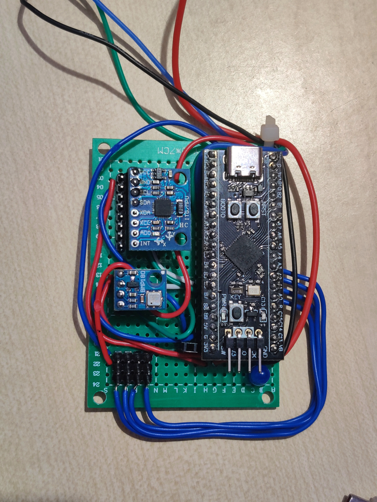
  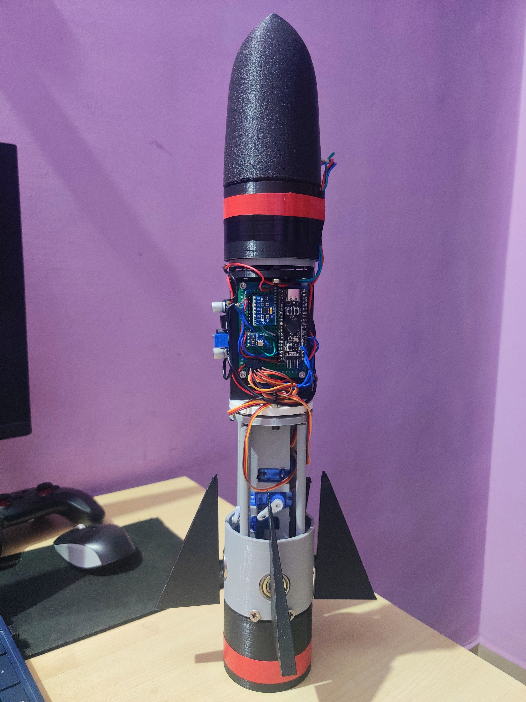

---

### Agribot
An autonomous robot for precision farming and harvesting. Part of trying to solve real problems with automation in agriculture.

  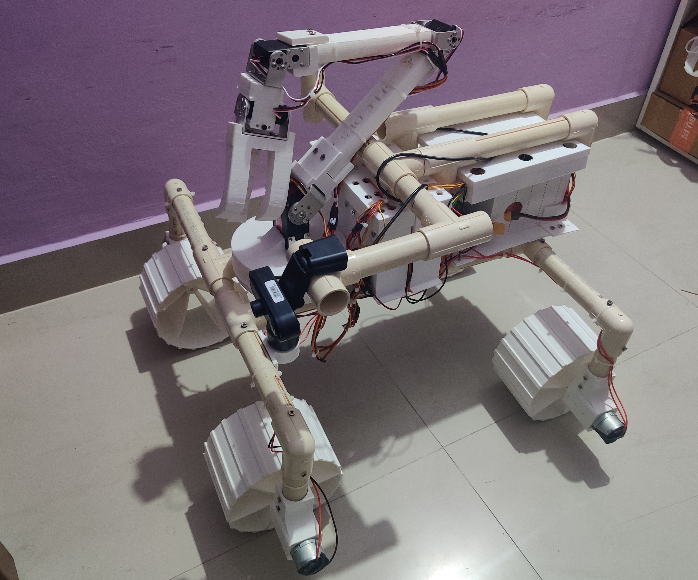
  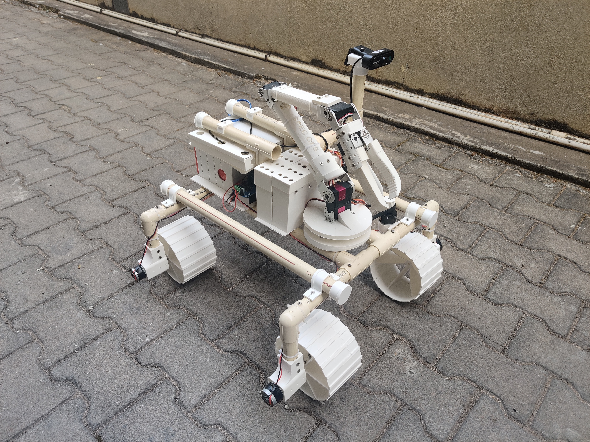

---

### Bio-Inspired Rocketry
Took inspiration from nature for rocket fin design. The idea was to use bio-inspired shapes for better controlled steering in rockets.

  
  

---

### Bird Control System
An automated system to handle bird problems in agricultural and industrial settings. Practical automation for a real-world nuisance.

  
  

---

### Chimaera 5-DOF Robotic Arm
My take on a 5-DOF arm with custom design work. Spent a lot of time on the control systems to get smooth motion.

  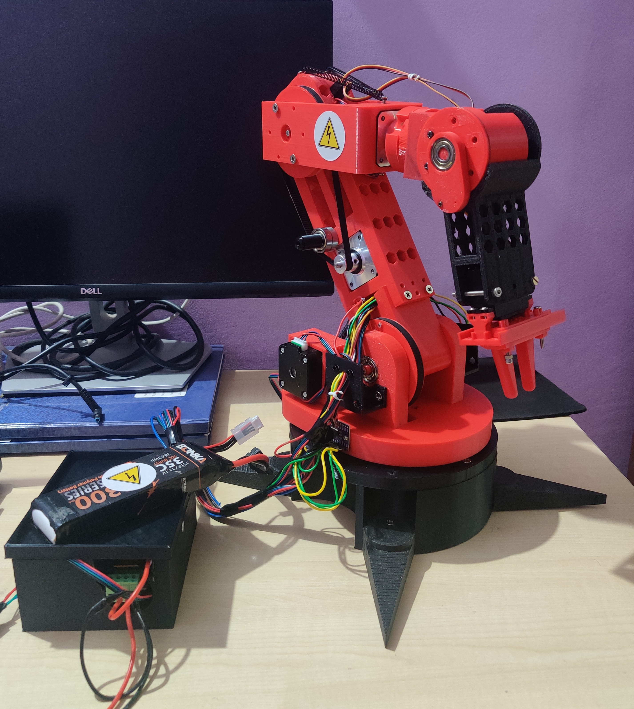
  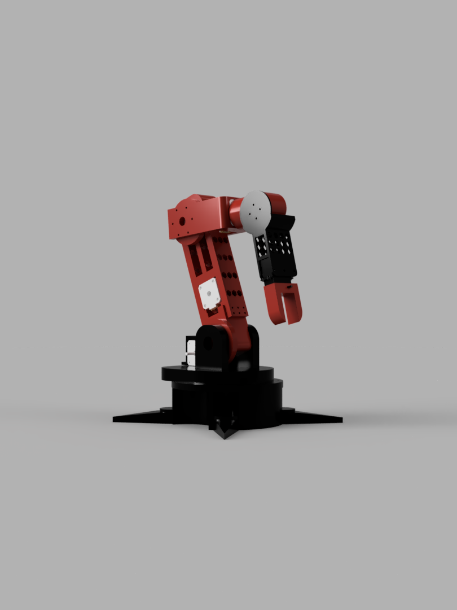

---

### CNC Plotter
Built a 2-axis CNC plotter from scratch. Custom mechanics, STM32-based control, and a full workflow from CAD to G-code execution.

  
  

---

### Delta Robotic Arm
A 3-DOF parallel robot designed for speed. Great for pick-and-place automation. Did a bunch of motion simulation and workspace analysis to optimize the design.

  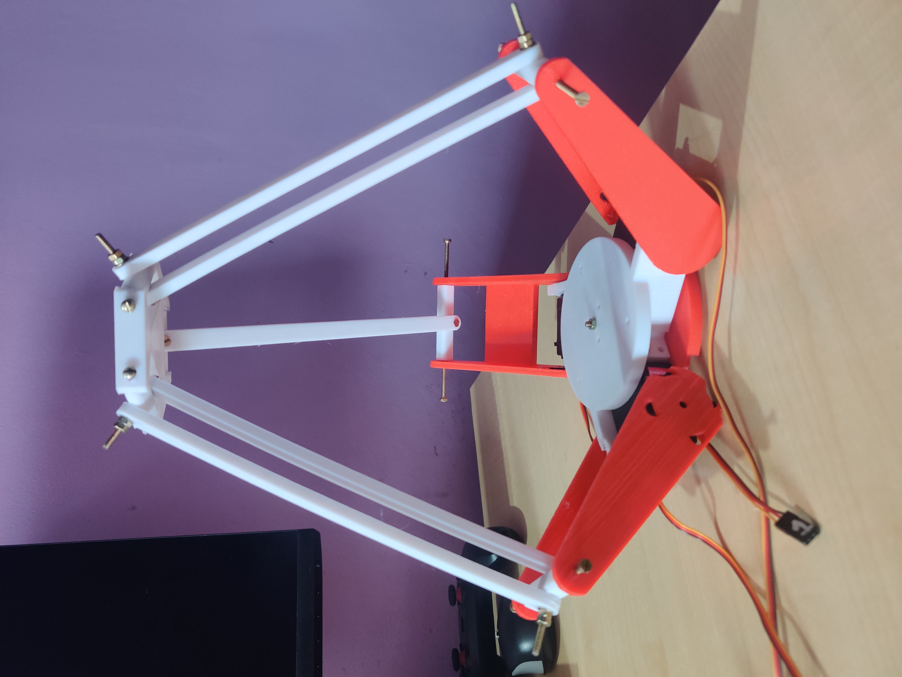
  

---

### Higgs ML Pipeline
A machine learning pipeline I put together for data processing and model training. Good learning experience for ML workflows.

  

---

### Network Traffic Analyzer
Built a system to monitor and analyze network traffic. Useful for understanding security issues and performance bottlenecks.

  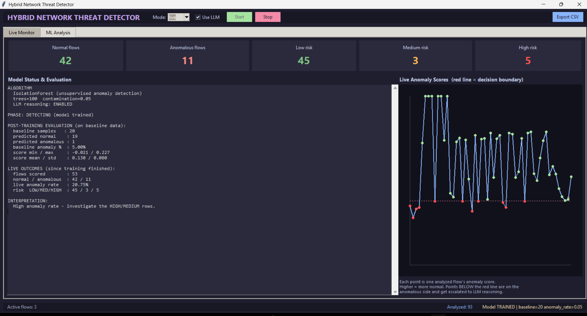
  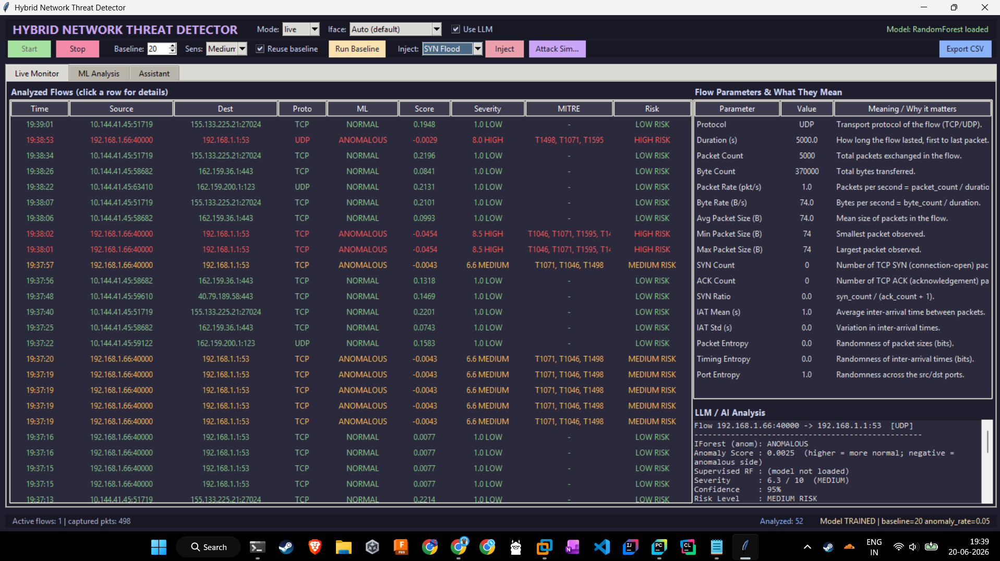

---

### PRRR Robotic Arm
A parallel redundant arm design focused on reliability and precision. Redundancy means fewer single points of failure.

  
  

---

### Quadruped Robot
A four-legged robot platform. Been working on autonomous navigation and getting it to handle different types of terrain.

  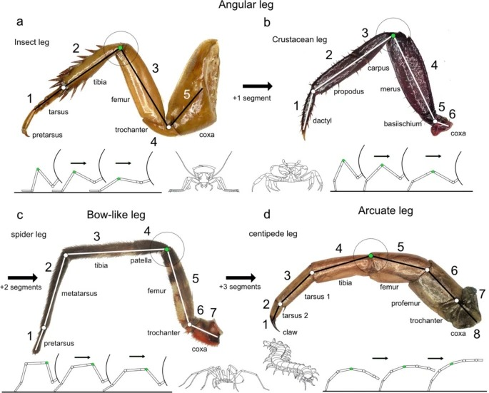
  

---

### Railway Inspection Robot
An autonomous inspection robot that uses computer vision and embedded sensors to monitor railway tracks. A mix of vision systems and hardware sensing.

  
  

---

### Rocket Flight Controller PCB
Designed a custom PCB for a rocket flight computer. Includes thrust-vector control and telemetry systems. PCB design is always satisfying when it works.

  
  

---

### STM32 Quadcopter
Built a quadcopter around an STM32 flight controller. Has flight control systems and some autonomous capabilities. Drones are fun but also frustrating to tune.

  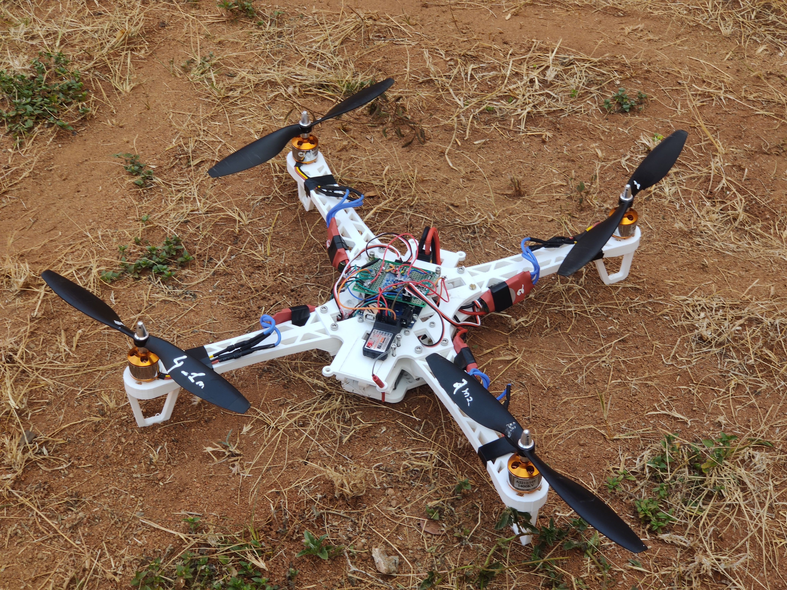
  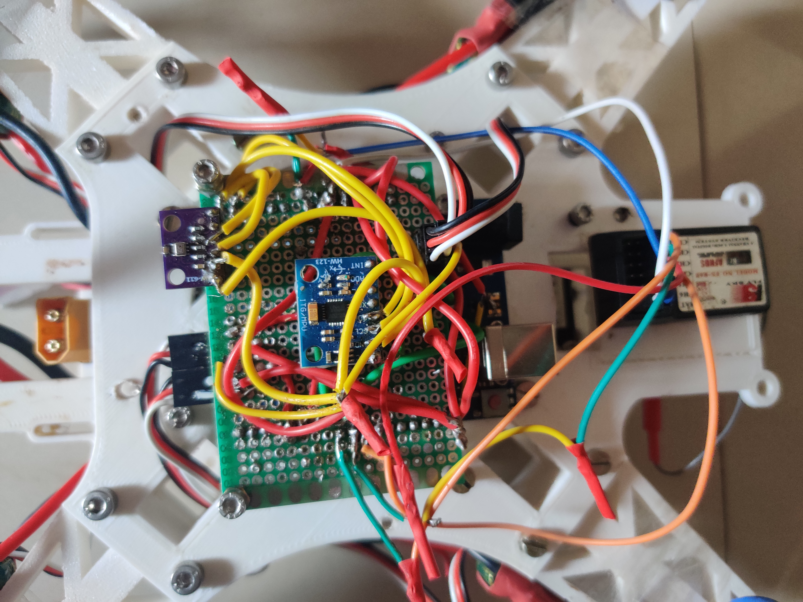

---

### Additional Project Images

  
  
  
  

## Achievements

- Won 4 hackathons (Creat-a-thon, TECHNOTSAV, EPOCH, Project Expo)
- Filed 2 patent applications: one for bio-inspired fin design, another for smart telemetric hydro-storage
- Published 2 papers with IEEE on space robotics and agricultural automation
- BIRAC E-YUVA Fellow in 2026 for work on smart telemetric hydro-storage orthodontic appliances

## Background

- **Education**: Bachelor of Engineering from JSS Science and Technology University (CGPA: 9.35)
- **Work**: Firmware summer intern at Western Digital, worked on NAND subsystem validation

## Get in Touch

- **GitHub**: [Prathviraj-mv](https://github.com/Prathviraj-mv)
- **Portfolio**: Check out `index.html` for the full portfolio website

---

*Updated October 2026*
